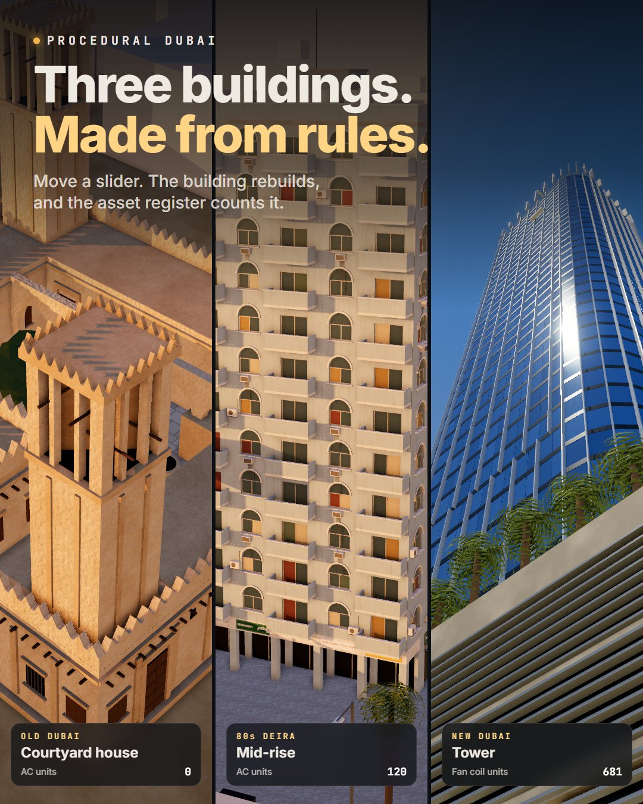

# Procedural Dubai

Three original Dubai buildings, generated from rules and rebuilt live in your browser. An asset register
counts what the rules place.

**Live demo:** https://mohdimran32000.github.io/procedural-dubai/

## What a procedural tool is

You don't model the building. You write the rules that make it: a bay is 3.6 m wide, every second bay gets a
balcony, the top gets a parapet and water tanks. The numbers become inputs. Change one and the rules run again,
and you get a new building in a few milliseconds.

The **seed** is a dice roll for the random choices, such as which windows get an AC unit, which curtains are drawn
and what each shop sells. The same seed always gives the same building.

## The three rule sets

| Building | Rules you can change |
|---|---|
| **Old Dubai courtyard house** | plot size, wind towers (barjeel) and their height, upper rooms, courtyard arcade, parapet style, courtyard planting |
| **80s Deira mid-rise** | floors, bays, facade style (arches, bands, grid), balconies and their pattern, AC units on the facade, shop arcade, bilingual shop signs, paint |
| **New Dubai tower** | floors, floor plate, corners, twist, taper, podium levels, glass tint, fins, crown |

A generic city grid wraps around the building: clay massing, roads, crossings, kerbs, lamps, palms, parked
cars and, for the tower, a canal. "Clear the view" keeps the blocks in front of the building low.

## The asset register

The same rules that draw the building count what they place, so the register updates with every slider. Each
row shows the rule behind it. Examples:

| Count | Rule |
|---|---|
| Split and window AC units (Deira) | one per fitted window or balcony, plus roof units |
| Roof water tanks (Deira) | 1 per 4 apartments, as many as fit on the roof |
| AC units (courtyard house) | 0: the wind towers and 60 cm walls do the cooling |
| Fan coil units (tower) | 3 per apartment: living room + 2 bedrooms |
| Lifts (tower) | 1 per 70 apartments, never below 4 |
| BMU drops per clean (tower) | top perimeter / 3.6 m cradle |
| Sprinkler heads (tower) | 1 per 12 m² of floor |

These are rule-of-thumb numbers for illustration. They are not a design and not a code check. The CSV button
exports the register with the parameters that produced it.

## Light and camera

Five light presets: Noon, Golden hour, Shamal (sand haze), Blue hour and Night. Six camera shots plus auto orbit.

## How it's built

- Plain ES modules, no build step. three.js r170 loads from jsdelivr.
- `js/buildings.js` holds the three rule sets. Each `build()` returns the geometry and the register rows.
- `js/city.js` builds the city grid. `js/core.js` has the seeded random generator, the geometry builder that
  merges thousands of boxes into a few draw calls, and the procedural textures (coral stone, painted render
  with dust streaks, pavers, the black-and-white kerb, the shop sign atlas).
- `js/main.js` covers the sky, light presets, shadows, ambient occlusion (GTAO), bloom and grade, plus the cameras.
- `js/film.js` is the timeline for the video. Open `index.html?film=1` and every frame is a pure function of
  time, so a headless browser can step through it and get the same video every time.

Run it locally from this folder with `python -m http.server`, then open http://localhost:8000.

## Notes

- Original, generic buildings. None is a real building, and the city is not a real place.
- The rules are written in JavaScript. No Blender and no geometry nodes.
- Made by Mohamed Imran with Claude Code (Opus 5.5).

MIT licence.
